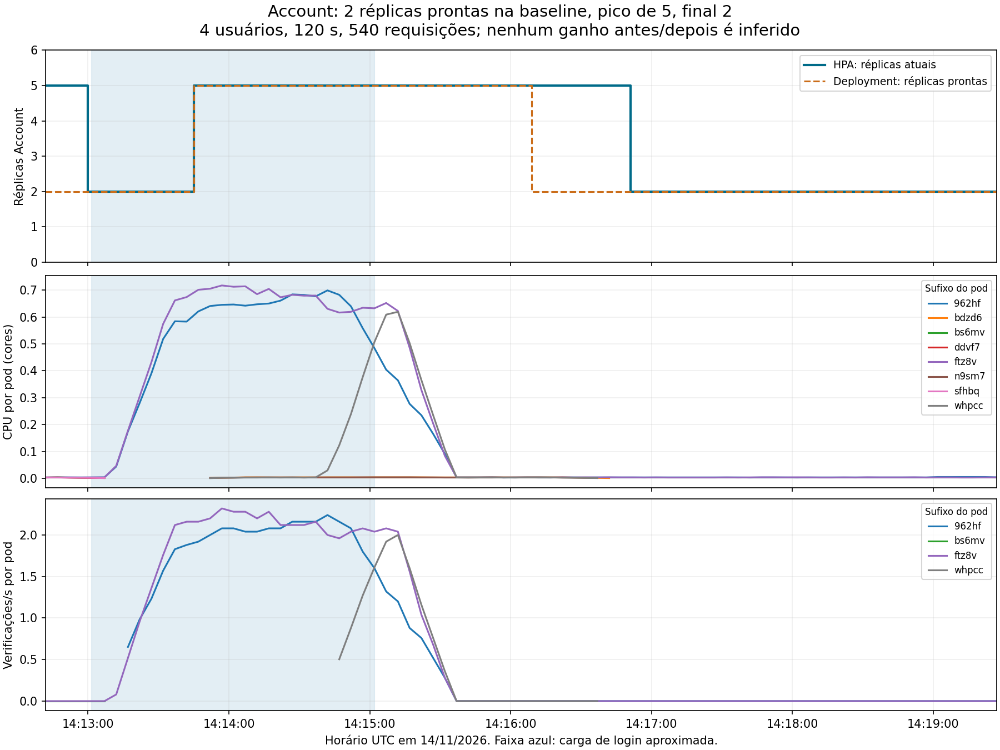

# Gargalos e testes

Foram implementados quatro tratamentos: observabilidade e balanceamento por Yuri Henrique; cache e mensageria por Gustavo Lina.

## Observabilidade — Yuri Henrique

**Problema:** dificuldade para relacionar latência e erros ao consumo de recursos.

**Implementação:** métricas de requisições e processos, Prometheus, painéis Grafana e logs estruturados. Os registros evitam senhas, tokens e dados pessoais.

**Resultado:** durante a carga de login, as métricas permitiram correlacionar a verificação Argon2id em Account ao consumo de CPU e ao escalonamento. Após a retomada, os 12 alvos Prometheus foram encontrados saudáveis. A solução não inclui tracing distribuído ou agregador central de logs.

## Balanceamento — Yuri Henrique

**Problema:** concentração de tráfego e dependência de uma única réplica.

**Implementação:** duas réplicas por serviço, Services ClusterIP, verificações de saúde, rolling updates e HPA. Account permite identificar o pod que respondeu.

**Resultado:** três pods Account atenderam verificações de credenciais na rodada EKS. O HPA apresentou o ciclo **2 → 5 → 2 réplicas prontas**. A distribuição foi desigual; não foi medido ganho controlado antes/depois. Em teste separado no Kind, a substituição de um pod preservou a identidade e as 30 consultas retornaram HTTP 200.

Um port-forward fixa uma réplica do serviço encaminhado. O teste de recuperação local não comprova tolerância a falha de máquina ou de zona na AWS.

## Cache e mensageria — Gustavo Lina

| Tratamento | Implementação | Evidência e limite |
|---|---|---|
| Cache | Redis em consultas de Product, com expiração e invalidação | Aceite EKS comprova HIT, BYPASS e consistência após exclusão; comparação de latência foi feita separadamente em Compose |
| Mensageria | Eventos de pedido e consumidor de notificações com idempotência | Aceite EKS comprova processamento e replay; teste de indisponibilidade/retomada foi local |

A fila desloca um efeito secundário do pedido para processamento assíncrono. Os testes não garantem processamento exatamente uma vez em toda janela de falha. A documentação individual dos dois tratamentos é de Gustavo.

## Resultados no EKS

Em 14/11/2026, a aplicação utilizou dois workers `t3a.medium`. A carga de negócio percorreu produtos, pedidos e câmbio, com pausa de 500 ms entre iterações e até duas tentativas de criação de pedido por usuário.

| Cenário | Usuários | Duração nominal | Requisições | p95 | Erros |
|---|---:|---:|---:|---:|---:|
| Negócio | 1 | 60 s | 127 | 416 ms | 0% |
| Negócio | 4 | 60 s | 508 | 414 ms | 0% |
| Negócio | 8 | 60 s | 976 | 434 ms | 0% |
| Login | 4 | 120 s | 540 | 1.156 ms | 0% |

Foram 1.611 requisições de negócio. Os percentis incluem rede e port-forward; resultados agregados não comprovam latência de cada rota nem disponibilidade mensal.

## Reprodução e evidências

Os testes funcionais são executados por `tests/smoke.py` e `tests/business_integration.py`. A carga utiliza `scripts/load.py` e `scripts/load-business.py`. O HPA requer Metrics Server, requests de CPU e capacidade disponível nos nós. Novas rodadas AWS precisam de janela e orçamento definidos.

- [Relatório completo de carga e HPA](final-validation.md).
- [Resumo de escalonamento e tráfego por pod](evidence/2026-11-14-eks/hpa/summary.json).
- [Vídeo técnico de carga e HPA](evidence/2026-11-14-eks/hpa/hpa-evidence.mp4): replay identificado de saídas reais, com contexto e horários.
- [Recuperação de pod no Kind](evidence/2026-11-13-local/pod-recovery.json).
- [Cache em Compose](evidence/2026-11-12-preparation/load-cache.json) e [bypass](evidence/2026-11-12-preparation/load-bypass.json).
- [Retomada local da mensageria](evidence/2026-11-12/resilience.json).
- [Aceite integrado EKS de 22/11](evidence/2026-11-22-resume/business-integration.json).
