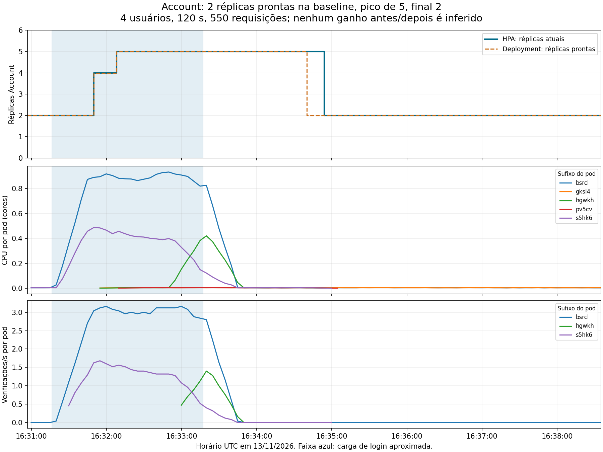

# Carga e HPA reais no EKS — 13/11/2026

A rodada desta página é histórica, executada nas máquinas grandes.
Para os workers menores e a carga de negócio progressiva, consultar a
[validação de 14/11](final-validation.md).

## Resultado da rodada autorizada

O operador autorizou uma rodada de **quatro usuários por 120 segundos**, com
observação posterior, reservando aproximadamente US$ 0,20 do orçamento
adicional de US$ 20. Não foram criadas máquinas ou novos serviços AWS.
O inventário permaneceu com dois workers e a EC2 Jenkins, todos t3.large.
[Checagem final de configuração](evidence/2026-11-13-eks/hpa/cost-guard-final.json).
Ela não mede a fatura nem garante custo máximo.

O cenário foi login real, pelo Gateway em `store-eks`, usando Auth Java,
Account Python e RDS. O cliente acessou o cluster por port-forward.
Os serviços de B não foram modificados.

| Indicador | Resultado |
|---|---:|
| Usuários concorrentes | 4 |
| Duração solicitada / observada da carga | 120 s / 120,625 s |
| Requisições medidas | 550 |
| Respostas HTTP 200 | 550 |
| Erros observados | 0% |
| Vazão | 4,56 req/s |
| Latência p50 | 843 ms |
| Latência p95 | 1.187 ms |
| Latência p99 | 1.281 ms |
| Réplicas prontas Account | 2 na baseline, 5 no pico, 2 no final |

[Relatório de carga](evidence/2026-11-13-eks/hpa/login-load.json),
[resumo verificável](evidence/2026-11-13-eks/hpa/summary.json) e
[capturas estruturadas](evidence/2026-11-13-eks/hpa/recorded-hpa.json).

## Escalonamento provocado pela carga

O próprio controlador HPA registrou os seguintes eventos para Account:

| Horário UTC | Evento |
|---|---|
| 16:31:41 | SuccessfulRescale: 4 réplicas, CPU acima do alvo |
| 16:31:56 | SuccessfulRescale: 5 réplicas, CPU acima do alvo |
| 16:34:41 | SuccessfulRescale: 2 réplicas, métricas abaixo do alvo |

[Eventos completos](evidence/2026-11-13-eks/hpa/hpa-events.json). Os avisos de
métricas de 15:44 pertencem à inicialização anterior dos serviços; foram
preservados na fonte e não são falhas observadas nesta carga de 16:31.

As cinco réplicas chegaram a ficar prontas e disponíveis. O snapshot de
comandos e o HPA são lidos sequencialmente, portanto os timestamps dos frames
não representam uma transação atômica do cluster. Para horários do controlador,
usar os eventos acima. O scaleDown configurado tem estabilização de 60 s.



O azul indica aproximadamente a janela de carga. A CPU sobe em Account,
o HPA aumenta as réplicas e, após cessarem as requisições, CPU e réplicas caem.
O pico capturado no HPA foi **689% dos requests de CPU**, e não 689% da máquina:
Account tem request de 100m por pod e alvo de 60%. Um dos processos atingiu
aproximadamente 0,93 core, próximo de seu limite de 1 core.

## Gargalos de A: diagnóstico e distribuição

**Observabilidade:** as métricas de CPU de Account acompanharam o tráfego de
verificação de credenciais. A correlação com a rota interna identifica o
caminho de autenticação como foco de capacidade neste cenário. O código usa
Argon2id em Account, mas não foi feito profiling que atribua toda a latência
exclusivamente à função de hash. Não apresentar essa execução como medição
isolada do custo de Argon2id.

**Balanceamento:** a métrica de requisições por pod confirmou que três
instâncias de Account atenderam `/internal/credentials/verify`, incluindo
uma réplica adicionada durante a carga. A distribuição foi desigual: conexões
persistentes podem manter tráfego nas réplicas antigas, e cinco pods prontos
não significam cinco pods igualmente ocupados. As séries e as consultas PromQL
estão nos [dados do Prometheus](evidence/2026-11-13-eks/hpa/prometheus-during.json).

O relatório do cliente informa `upstream_instances=unknown`, pois o login não
retorna o identificador Account ao cliente. A evidência de distribuição vem
das métricas por pod, não de headers que não foram observados. O túnel fixa
uma réplica de Gateway; esta rodada não comprova balanceamento entre Gateways.

Não contar observabilidade, balanceamento e HPA como três gargalos individuais:
A tem observabilidade e balanceamento; HPA é evidência complementar de escala.

## Vídeo técnico

[Abrir ou baixar o vídeo de HPA EKS](evidence/2026-11-13-eks/hpa/hpa-evidence.mp4).

O vídeo tem **7 min 41 s** e é um **replay identificado de saídas reais de
comandos**, com contexto e timestamps. Ele inclui baseline, pico de cinco
réplicas, retorno a duas e os seis Deployments de API no mesmo cluster.
Não é captura do desktop nem substitui o vídeo humano de apresentação de
1–2 minutos. [Proveniência e hash](evidence/2026-11-13-eks/hpa/provenance.json).

Frames de conferência: [baseline](evidence/2026-11-13-eks/hpa/baseline.png),
[pico](evidence/2026-11-13-eks/hpa/peak.png),
[final](evidence/2026-11-13-eks/hpa/final.png).

## Reprodução e limites

A reprodução gera custo variável e requer nova autorização. O comando abaixo
é referência, **não uma autorização para nova execução**. Preparar primeiro o
port-forward do EKS e usar um diretório de saída novo para não sobrescrever
evidência. Ferramentas de vídeo e gráfico executam no computador local.

```powershell
python -m pip install -r requirements-video.txt -r requirements-analysis.txt
python scripts/record-hpa.py --context store-eks --base-url http://127.0.0.1:18080 --users 4 --duration 120 --cooldown 300 --output-directory artifacts/eks/nova-rodada-autorizada --allow-eks-load
```

`scripts/summarize-hpa.py` resume capturas e dados Prometheus já coletados, sem
contatar AWS ou gerar carga. Os hashes de origem ficam no resumo. A rodada
teve consultas finais somente de leitura concluídas além do horário-alvo de
observação; não houve carga adicional. O coletor foi ajustado posteriormente
para não iniciar outra consulta após atingir seu prazo. A gravação publicada
é a execução anterior a esse ajuste, sem alegar reexecução.

Esta é uma única rodada de login: não é benchmark controlado antes/depois,
carga de todos os fluxos de negócio, comprovação de disponibilidade mensal ou
de capacidade ilimitada. A latência inclui o caminho de rede/port-forward.
O p95 de leitura de identidade e a criação/consulta de pedidos precisam de
seus próprios cenários; não usar o p95 de login como resultado dessas rotas.
O HPA atingiu seu teto de cinco pods. Para nova baseline/carga progressiva ou
falha controlada, combinar escopo, duração e custo antes de executar.
