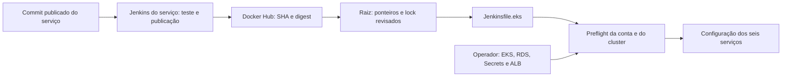

# Preparação do deploy completo no EKS

## Sem domínio próprio — opção padrão desde 13/11

É possível implantar os seis serviços no EKS sem comprar domínio. O arquivo de exemplo agora usa `"access_mode": "port-forward"`. Nesse modo, domínio, certificado ACM e sub-redes de ALB não são exigidos; a release não cria Ingress nem LoadBalancer. Os custos de EKS, workers, RDS, NAT, volumes e demais recursos usados continuam existindo.

Mantenha esses campos assim em `.env.eks.json`, preservando conta, CIDR e demais dados reais:

```json
{
  "access_mode": "port-forward",
  "domain": "",
  "certificate_arn": "",
  "public_subnets": []
}
```

O trecho acima mostra somente os campos de acesso: não substituir o arquivo completo por ele. Pular a solicitação ACM e a instalação do ALB Controller nas instruções abaixo. Criar RDS, namespaces/Secrets, aplicar foundation, instalar dependências/monitoramento e executar o job de release normalmente. Na stack IAM do agente, omitir CertificateArn; as permissões de leitura ACM/ALB também são omitidas.

Após o deploy, abrir um terminal com o perfil operador autorizado e manter o túnel ativo:

```powershell
kubectl --context store-eks -n store port-forward service/gateway 18080:8000 --address 127.0.0.1
```

Em outro terminal:

```powershell
$env:BASE_URL='http://127.0.0.1:18080'
python tests/smoke.py
python tests/business_integration.py
python scripts/load-business.py --base-url $env:BASE_URL --scenario business --users 4 --duration 60 --context store-eks
```

A aplicação executada é a do EKS, mesmo com URL local. O acesso depende da identidade Kubernetes/AWS autorizada e não fornece um link público ao professor. O perfil restrito do CI não concede abertura de port-forward; usar o perfil operador. O túnel fixa um pod de Gateway, então gerar carga dentro do cluster para testar o balanceamento entre réplicas do próprio Gateway. As chamadas aos Services internos continuam sujeitas ao balanceamento Kubernetes. [Referência Kubernetes](https://kubernetes.io/docs/tasks/access-application-cluster/port-forward-access-application-cluster/).

Para disponibilizar uma URL pública HTTPS posteriormente, mudar explicitamente para `"access_mode": "https-alb"` e preencher os campos de domínio/certificado/sub-redes. Arquivos antigos sem access_mode mantêm o comportamento HTTPS anterior. Trocar para port-forward não apaga um ALB existente: se já houve publicação pública, o operador deve remover o Ingress e aguardar a exclusão do balanceador. Não foi criado ALB nesta preparação.

Preparação da Pessoa A em 12/11/2026. Os seis serviços continuam nos commits publicados pelos respectivos autores. Nenhum recurso pago AWS foi criado nesta etapa. Os comandos de provisionamento abaixo ficam para a janela de implantação, depois de conferir conta, preços e parâmetros reais.

## O que está preparado

| Frente | Implementação |
|---|---|
| Imagens | Seis imagens públicas com SHA de origem e digest em `infra/aws/images.lock.json` |
| Cluster | Kubernetes 1.35, duas zonas, nós privados, endpoint privado e acesso público limitado ao CIDR informado |
| Capacidade inicial | Dois t3.large; limite configurado de quatro nós; aumento de nós é uma ação explícita, sem Cluster Autoscaler instalado |
| Banco | RDS PostgreSQL 16 privado, criptografado, Single-AZ, inicialmente db.t4g.small/20 GiB; minor disponível resolvido na região |
| Isolamento | Bancos accounts/products/orders e usuários account_app/product_app/order_app; bootstrap idempotente e acesso cruzado negado |
| TLS no banco | Bundle público de CAs RDS versionado; URLs com `verify-full` e certificado montado nos três serviços de dados |
| Fila | RabbitMQ StatefulSet, uma réplica, PVC gp3 criptografado de 2 GiB e retenção do volume |
| Cache | Redis reconstruível, sem persistência, memória limitada e expiração/invalidação mantidas em Product |
| Acesso | Port-forward sem domínio por padrão; Ingress ALB com ACM/HTTPS como opção pública |
| CI/CD | Build/publicação por serviço; `Jenkinsfile.eks` aplica a configuração de nuvem dos seis serviços em conjunto |
| IAM/RBAC | Identidade EC2 para o agente; APIs AWS de leitura para preflight; alterações Kubernetes restritas à aplicação no namespace store |
| Operação | Renderização, verificações offline/AWS, snapshot anterior, aplicação e rollback dos recursos da aplicação |

Os arquivos e scripts citados pertencem ao [repositório principal](https://github.com/Microserv-1/store-root). A renderização lê os manifests de B sem alterá-los. Não é necessário um novo commit de B para usar o pipeline de release preparado aqui.



## Reproduzir a preparação sem AWS

PowerShell, na raiz:

```powershell
python -m venv .venv-ops
.venv-ops/Scripts/python -m pip install -r requirements-ops.txt
.venv-ops/Scripts/python -m unittest discover -s tests -p test_eks_preparation.py
.venv-ops/Scripts/python scripts/prepare-eks.py render --example
.venv-ops/Scripts/python scripts/eks-preflight.py --local-context kind-microserv-store
```

O exemplo gera `artifacts/eks/`: `eksctl.rendered.yaml`, `foundation.json`, `applications.json`, `bootstrap.json`, `release.json`, metadados e entradas para custos. É uma prévia com `example_only=true`; não aplicar esses exemplos na AWS. O dry-run no Kind verifica schemas da API, sem executar EBS, ALB ou IAM.

`prepare-eks.py lock` consulta as tags públicas dos seis SHAs do checkout e registra seus digests. Executar depois de publicar novas imagens, revisar e versionar o lock com os ponteiros da raiz. Uma tag SHA pode ser sobrescrita por outro build; o digest identifica a imagem usada na release.

O teste `tests/eks_dependencies.py` cria um namespace isolado no Kind, usa a StorageClass local `standard`, testa substituição dos pods e remove somente o namespace identificado pelo próprio teste. Não usa a fila da aplicação. O armazenamento EBS permanece uma verificação futura na AWS.

## Dados externos necessários

Preencher uma cópia ignorada `infra/aws/deploy.example.json` → `.env.eks.json`:

- Conta AWS e identidade do operador, região e zonas disponíveis; quotas EC2/EKS e orçamento.
- CIDR público real do operador, preferencialmente `/32`. Não usar o CIDR de documentação ou `0.0.0.0/0`.
- Somente para https-alb: domínio controlado pela dupla e certificado ACM **ISSUED** na mesma região, cobrindo esse domínio.
- Após criar o cluster: VPC, sub-redes privadas e security group realmente associado aos workers; somente para https-alb, duas sub-redes públicas do ALB.
- Após criar RDS: endpoint privado e minor PostgreSQL 16 disponível na região.
- Identidade do agente Jenkins, acesso de rede ao endpoint EKS e credenciais de checkout/registry.

A versão 1.35 foi escolhida com base no [calendário oficial EKS](https://docs.aws.amazon.com/eks/latest/userguide/kubernetes-versions.html). O preflight reconsulta o suporte da versão na conta/região no momento do deploy. Não reutilizar a exceção de TLS do Metrics Server usada no Kind.

## Ordem de implantação na AWS

### 1. Conferir identidade e preparar o cluster

Instalar AWS CLI v2, eksctl, kubectl 1.35 e Helm no ambiente do operador. O agente preparado em `infra/jenkins/Dockerfile` já contém AWS CLI 2.39.7, kubectl 1.35 e Python/venv. O Compose de Jenkins local mantém kubectl 1.32.2 para o Kind 1.32.

```powershell
aws sts get-caller-identity
aws eks describe-cluster-versions --cluster-versions 1.35 --region us-east-1
.venv-ops/Scripts/python scripts/prepare-eks.py cluster --config .env.eks.json
eksctl create cluster --config-file artifacts/eks/eksctl.rendered.yaml --dry-run
```

O modo `cluster` exige conta/CIDR reais, mas permite que domínio, certificado e IDs das futuras sub-redes ainda estejam vazios. Conferir o plano e a estimativa antes do comando que cria recursos pagos:

```powershell
eksctl create cluster --config-file artifacts/eks/eksctl.rendered.yaml
aws eks update-kubeconfig --name microserv-store --region us-east-1 --alias store-eks
kubectl --context store-eks get nodes
```

O eksctl configura OIDC e add-ons de rede, Metrics Server e EBS CSI. Guardar as versões efetivamente resolvidas por `eksctl get addons --cluster microserv-store --region us-east-1`. A [configuração de add-ons](https://docs.aws.amazon.com/eks/latest/eksctl/addons.html) e as [permissões do EBS CSI](https://docs.aws.amazon.com/eks/latest/userguide/ebs-csi.html) devem ser conferidas na região.

### 2. Criar RDS e inicializar os três bancos

`scripts/eks-secrets.py generate` gera `.env.eks` uma vez; a etapa local já o criou. Não sobrescrever credenciais existentes. Esse arquivo é ignorado pelo Git. O usuário mestre é `store`; as aplicações nunca recebem sua senha.

Usar VPC, duas sub-redes privadas em zonas distintas e SG dos workers reais nos argumentos seguintes. O helper descobre um minor PostgreSQL 16 disponível, lê a senha do arquivo ignorado e grava parâmetros em `secrets/rds-parameters.json`:

```powershell
.venv-ops/Scripts/python scripts/rds-parameters.py --vpc <vpc-id> --private-subnets <subnet-privada-a> <subnet-privada-b> --worker-sg <sg-dos-workers> --discover-engine --region us-east-1
aws cloudformation create-stack --stack-name microserv-store-rds --template-body file://infra/aws/rds.yaml --parameters file://secrets/rds-parameters.json --region us-east-1
aws cloudformation wait stack-create-complete --stack-name microserv-store-rds --region us-east-1
aws cloudformation describe-stacks --stack-name microserv-store-rds --region us-east-1
```

Não passar senhas literais na linha de comando. O template usa `NoEcho`, não tem senha em Outputs e retém snapshot ao excluir/substituir o banco. O cfn-lint registra W1011 por preferir referências dinâmicas: foi mantido o parâmetro NoEcho com arquivo local ignorado neste roteiro acadêmico. Proteger esse arquivo e a credencial do operador; migrar para um gerenciador de segredos caso o ambiente seja compartilhado.

Preencher `PGHOST` em `.env.eks` com o endpoint privado obtido. Conferir `.env.eks.json`; preencher domínio/certificado/sub-redes públicas somente no modo https-alb. Renderizar a release real:

```powershell
.venv-ops/Scripts/python scripts/prepare-eks.py render --config .env.eks.json
.venv-ops/Scripts/python scripts/eks-secrets.py check
kubectl --context store-eks apply -f infra/k8s/namespace.yaml
kubectl --context store-eks apply -f infra/aws/bootstrap-namespace.yaml
.venv-ops/Scripts/python scripts/eks-secrets.py apply-bootstrap --context store-eks --config .env.eks.json
kubectl --context store-eks apply -f artifacts/eks/bootstrap.json
kubectl --context store-eks -n store-bootstrap wait --for=condition=complete job/rds-bootstrap --timeout=300s
kubectl --context store-eks -n store-bootstrap logs job/rds-bootstrap
```

O bootstrap cria/atualiza os usuários, cria os bancos ausentes, revoga acesso público e testa DDL/DML e bloqueio cruzado. Se encontrar um banco existente com outro proprietário, interrompe; migrar explicitamente, preservando dados. Não usar o bootstrap para assumir um banco de outra instalação. Para reexecutar o Job, remover o Job anterior e reaplicar; não excluir os bancos.

Após sucesso, excluir o Job e o Secret administrativo do namespace de bootstrap e instalar apenas os segredos de aplicação:

```powershell
kubectl --context store-eks -n store-bootstrap delete job/rds-bootstrap secret/rds-bootstrap
.venv-ops/Scripts/python scripts/eks-secrets.py apply-app --context store-eks --config .env.eks.json
```

Os scripts de aplicação de Secrets conferem a identidade AWS e o endpoint do kubeconfig antes de enviar os dados por stdin. O arquivo mestre fica local e não entra nos artefatos do Jenkins.

### 3. Dependências, observabilidade e ALB opcional

No modo port-forward, pular o bloco de instalação do ALB Controller e seguir diretamente para a instalação da foundation e das dependências. O bloco seguinte se aplica somente a https-alb.

`infra/aws/controller.lock.json` fixa chart 1.16.0/controller v2.16.0. A política IAM correspondente está versionada em `infra/aws/lbc-iam-policy.json`. Criar a política na conta e associá-la por IRSA ao ServiceAccount `aws-load-balancer-controller` em `kube-system`, conforme o [guia oficial](https://kubernetes-sigs.github.io/aws-load-balancer-controller/v2.16/deploy/installation/).

```powershell
aws iam create-policy --policy-name MicroservStoreLoadBalancerController --policy-document file://infra/aws/lbc-iam-policy.json
eksctl create iamserviceaccount --cluster microserv-store --region us-east-1 --namespace kube-system --name aws-load-balancer-controller --attach-policy-arn arn:aws:iam::<conta>:policy/MicroservStoreLoadBalancerController --approve
helm repo add eks https://aws.github.io/eks-charts
helm repo update
helm upgrade --install aws-load-balancer-controller eks/aws-load-balancer-controller --kube-context store-eks --namespace kube-system --version 1.16.0 --set clusterName=microserv-store --set region=us-east-1 --set vpcId=<vpc-id> --set serviceAccount.create=false --set serviceAccount.name=aws-load-balancer-controller
kubectl --context store-eks -n kube-system rollout status deployment/aws-load-balancer-controller --timeout=300s
```

Nos dois modos, instalar a infraestrutura compartilhada da aplicação:

```powershell
kubectl --context store-eks apply -f artifacts/eks/foundation.json
kubectl --context store-eks -n store rollout status statefulset/rabbitmq --timeout=300s
kubectl --context store-eks -n store rollout status deployment/redis --timeout=180s
.venv-ops/Scripts/python scripts/deploy-monitoring.py --context store-eks
```

O Ingress cria um ALB com HTTPS e redirecionamento; configurar o DNS do domínio para o hostname exibido por `kubectl --context store-eks -n store get ingress gateway`. Não aplicar o antigo `infra/k8s/gateway-public.yaml` junto: ele é um exemplo HTTP separado e criaria outro balanceador.

### 4. Configurar a identidade e o job de release

`infra/aws/jenkins-iam.yaml` cria uma role e InstanceProfile para um agente EC2 dedicado, com DescribeCluster e leitura de versão. Informar ClusterName; CertificateArn só é necessário no modo https-alb e habilita as leituras de certificado/sub-redes do preflight público. O agente EC2 deve estar em rede que alcance o endpoint privado EKS e usar IMDSv2; o container precisa alcançar o IMDS (hop limit compatível) ou receber credenciais temporárias por mecanismo equivalente. Não gravar chaves AWS no Git ou na imagem.

No host dedicado, com Git, Docker/Compose e Python instalados:

```bash
python3 scripts/setup-jenkins-local.py --aws
docker compose --env-file .env.jenkins.aws -f compose.jenkins.aws.yaml up --build -d
```

Essa configuração usa volume próprio, kubectl 1.35 e interface em loopback `8086`, acessível por túnel SSH/SSM. Não usa os mirrors locais nem a credencial fictícia do modo Kind. O Docker socket dá ao Jenkins controle do daemon: usar host dedicado confiável; para uma instalação compartilhada, separar controlador e agentes. Conferir região do Compose se alterar a configuração padrão us-east-1.

Associar a role ao grupo Kubernetes do deploy:

```powershell
aws eks create-access-entry --cluster-name microserv-store --region us-east-1 --principal-arn <role-arn-do-agente> --type STANDARD --kubernetes-groups store-deployers
```

O RBAC da foundation permite atualizar Deployment, ConfigMap, Service, HPA e PDB da aplicação; não concede Secrets, bootstrap, PVCs ou administração do cluster. Existem leituras limitadas adicionais para verificar nós, EBS CSI, Metrics API e status do controller. Código que pode alterar um Deployment continua sendo código confiável: essa separação não impede um deployer malicioso de tentar executar código que use os segredos da aplicação.

No Jenkins do agente AWS, configurar:

| Credencial | Uso |
|---|---|
| `github-read` | Checkout real da raiz e dos submódulos privados |
| `dockerhub` | Publicação nos seis repositórios públicos autorizados |
| `eks-config` | Arquivo `.env.eks.json` completo, sem senhas |
| `store-eks-kubeconfig` | Kubeconfig com autenticação exec/AWS CLI para a role do agente; sem certificado admin exportado |

O Jenkins local já possui jobs `github-store-*` e `store-eks-release` com SCM GitHub real. `scripts/jenkins-github.py --from-gh` reutilizou a identidade CLI existente, armazenada criptografada no Jenkins local. Isso não transforma o token em uma credencial de escopo mínimo: para um Jenkins compartilhado, usar uma credencial dedicada de leitura. Não executar novamente `jenkins-local.py mirrors` nesse modo.

Os jobs dos serviços publicam com `DEPLOY=false`. **No EKS, usar `Jenkinsfile.eks` para aplicar `applications.json`**, que mantém a montagem da CA do RDS. O deploy direto dos manifests originais por um Jenkinsfile de serviço pode remover essa configuração adicional. O modo local dos Jenkinsfiles continua válido para Kind.

O job `store-eks-release` usa `DEPLOY_EKS=false` por padrão: checkout real, ferramentas, testes de proteção, renderização e preflight offline. Para o deploy real, após o bootstrap, informar `DEPLOY_EKS=true` e `KUBE_CONTEXT` do kubeconfig da role. O pipeline verifica conta, versão, endpoint, nós, EBS e métricas; no modo público, verifica também certificado, VPC/sub-redes e ALB Controller. Salva o estado anterior, aplica os seis serviços e aguarda rollouts. Namespace, Secrets e infraestrutura são responsabilidade do operador.

### 5. Validar, registrar carga e conferir custos

Para port-forward, usar os comandos da seção inicial, com BASE_URL no loopback. O exemplo HTTPS seguinte se aplica ao modo https-alb.

```powershell
.venv-ops/Scripts/python scripts/eks-preflight.py --cloud --config .env.eks.json --cluster-context store-eks
$env:BASE_URL='https://<dominio-real>'
python tests/smoke.py
python tests/business_integration.py
python scripts/load-business.py --base-url $env:BASE_URL --scenario business --users 4 --duration 60 --context store-eks --output artifacts/eks-business-load.json
kubectl --context store-eks -n store get hpa
kubectl --context store-eks -n store top pods
```

Repetir níveis 1, 4 e 8 usuários com duração e ambiente registrados. O script mantém contas autenticadas por usuário, limita a criação de pedidos, verifica conteúdo das respostas e mede p50/p95/p99, vazão e erros por operação. Produtos de teste são removidos; contas/pedidos permanecem, pois não existe DELETE dessas entidades no contrato. Usar base de teste para rodadas prolongadas.

Para comparar cache, executar `--scenario products --cache enabled` e `--cache bypass` sob condições equivalentes. Não concluir ganho com uma única rodada curta. O `--context` deve corresponder ao cluster da URL testada; não misturar tráfego Compose com snapshots Kind.

Os dois nós são a capacidade inicial. HPA não adiciona nós: antes de testar todos os serviços simultaneamente no máximo, conferir requests alocados, pods Pending e limites de conexões do RDS. Cada pod de banco pode abrir até dez conexões com os pools atuais; 2 réplicas × 3 serviços permitem até 60, enquanto 5 × 3 permitem até 150. Medir `max_connections`, manter margem e aumentar a classe do RDS ou ajustar os pools com os autores antes de saturar. `eksctl scale nodegroup` permite aumentar explicitamente os workers até quatro; o maxSize não ativa autoscaling de nós sozinho.

`artifacts/eks/cost-inputs.json` lista as quantidades da região e as janelas de 72/730 horas. Preencher no [AWS Pricing Calculator](https://calculator.aws/) EKS, EC2/créditos CPU, EBS, RDS, NAT/processamento, ALB/LCUs, IPv4 público, tráfego, logs, backups/snapshots e o agente Jenkins, quando usado. Guardar link/exportação, data, horas e hipóteses antes de provisionar. Nenhum total ou cotação foi inventado na preparação.

## Rollback e encerramento

O job arquiva `rollback.json`, `new-resources.json`, imagens/digests e os manifests. Guardar o snapshot da release anterior antes de um novo deploy. Recuperar a versão anterior dos recursos da aplicação com o mesmo contexto/configuração:

```powershell
.venv-ops/Scripts/python scripts/eks-apply.py rollback --context store-eks --config .env.eks.json --from-file <rollback-json-arquivado>
```

O rollback confirma conta/endpoint, mas não depende de Metrics Server ou certificado público saudáveis para permitir recuperação. Restaura os recursos anteriores e aguarda rollouts. Não reverte dados/migrações nem exclui recursos que não existiam antes; revisar `new-resources.json`. Sem uma release anterior completa dos seis serviços, recuperar com o operador. Rodar smoke após restaurar.

RabbitMQ é uma réplica: persistência não é HA. EBS é zonal; um pod pode esperar capacidade na zona do volume após falha. Validar recriação na AWS e definir snapshot/backup se precisar recuperar perda do volume. Redis reinicia vazio e reconstrói o cache; não é fonte de verdade. RDS Single-AZ e NAT único também limitam disponibilidade.

Depois da janela de avaliação, preservar as evidências e a decisão de retenção dos dados. Remover o Ingress e aguardar exclusão do ALB **antes** de remover o controller/cluster. Excluir a stack RDS conforme a política de snapshot; executar `eksctl delete cluster` com o arquivo do cluster. Revisar e encerrar também agente Jenkins, políticas/roles criadas para o projeto, NAT, volumes/PVs retidos, snapshots, endereços públicos e logs remanescentes. A retenção de PVC/PV gp3 é intencional: excluir o namespace ou cluster não comprova que esses custos terminaram.

## Limites da conclusão local

Foram executados localmente schema eksctl, lint CloudFormation, dry-run dos recursos, isolamento/idempotência dos bancos, aplicação/rollback da configuração adicional dos seis serviços, recuperação do broker, permissões, carga de negócio e pipeline com SCM GitHub real. Os resultados desta rodada estão em [Estado e evidências](status.md).

Ainda exigem a AWS real: disponibilidade regional/quotas, criação e conectividade RDS, TLS de banco, IRSA/EBS/ALB, IAM da identidade do agente, DNS/ACM, preços finais, carga/HPA e vídeo no EKS. Esses itens são execução e dados do destino; não são apresentados como testes já realizados.
