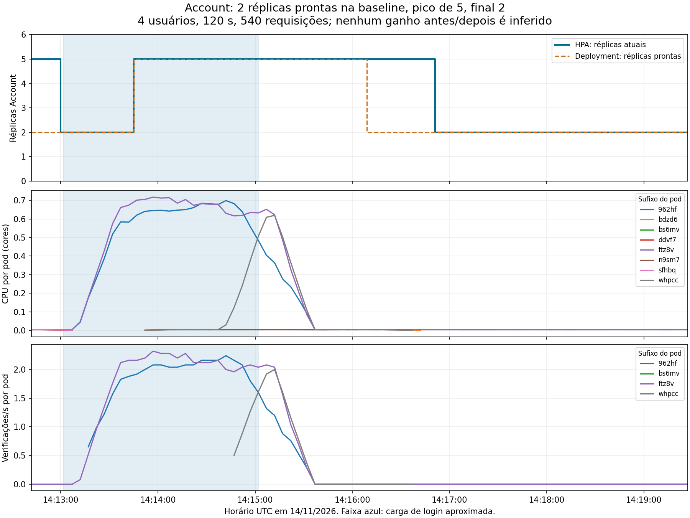

# Validação final no EKS — 14/11/2026

## Ambiente e escopo

Rodada limitada autorizada por Yuri: negócio com 1, 4 e 8 usuários por 60
segundos cada, seguido de login com quatro usuários por 120 segundos e
observação do HPA. Os serviços executam no `store-eks`, us-east-1, sobre dois
workers t3a.medium; Jenkins usa t3a.small. Não houve aumento manual de nós ou
limites. A aplicação é acessada por port-forward de um Gateway.

[Versões, imagens e ambiente](evidence/2026-11-14-eks/environment.json).
Os seis commits de serviço são os mesmos do aceite anterior; nenhum
microsserviço de B foi alterado. Os testes são tráfego real na AWS, não mocks.

## Integração funcional

Smoke Account/Auth/Gateway aprovado. O [aceite integrado de 40 verificações](evidence/2026-11-14-eks/business-integration.json)
também passou: produtos/pedidos, propriedade entre contas, rejeição de
credenciais inválidas, Redis, RabbitMQ, replay idempotente e conversão externa.
USD 26,44 resultou em BRL 150,08 nesta cotação open-er-api. A conversão não
altera o valor USD persistido. Diferenças em relação a 13/11 são cotações de
momentos diferentes, não mudança da regra de cálculo.

## Carga progressiva de negócio

Modelo fechado, pausa de 500 ms após cada iteração. Cada usuário pode tentar
criar no máximo dois pedidos; depois consulta os pedidos existentes. Produtos
de fixture são removidos; contas e pedidos permanecem como dados de teste.

| Usuários | Duração observada | Requisições | Req/s | p95 | p99 | Erros |
|---:|---:|---:|---:|---:|---:|---:|
| 1 | 61,832 s | 127 | 2,05 | 416 ms | 450 ms | 0% |
| 4 | 62,120 s | 508 | 8,18 | 414 ms | 492 ms | 0% |
| 8 | 60,841 s | 976 | 16,04 | 434 ms | 613 ms | 0% |

Foram **1.611 requisições medidas**, sem erros de status/payload. Os estágios
registraram respectivamente 2, 8 e 16 respostas 201 de criação de pedidos.
Não somar latências ou calcular média dos percentis: a tabela mostra cada
rodada separadamente. Setup e remoção de fixture não entram nas métricas.
As pequenas diferenças de duração decorrem de terminar as operações em curso.

Relatórios por operação: [1 usuário](evidence/2026-11-14-eks/business-1.json),
[4 usuários](evidence/2026-11-14-eks/business-4.json),
[8 usuários](evidence/2026-11-14-eks/business-8.json),
[resumo](evidence/2026-11-14-eks/business-summary.json).

Durante o estágio de oito usuários, uma consulta aos nós mostrou 28% e 22%
de CPU, 44% e 46% de memória, sem pods Pending. São amostras, não máximos
garantidos da rodada. Order chegou a cinco réplicas prontas após a carga de
negócio e depois reduziu. Diferenciar essa escala dos eventos do login.

## Login, CPU e HPA

Quatro usuários por 120 segundos produziram **540 respostas HTTP 200**, zero
erros e vazão de 4,48 requisições/s. Latências: p50 de 875 ms, p95 de 1.156 ms
e p99 de 1.515 ms. [Relatório do cliente](evidence/2026-11-14-eks/hpa/login-load.json).

Account apresentou o ciclo de **2 → 5 → 2 réplicas prontas**. Order chegou a
cinco após a carga de negócio e voltou a duas durante a observação de login;
são escalas distintas. Os eventos e capturas precisam ser lidos na ordem
temporal de cada etapa, sem atribuir todos os aumentos ao login.

O controlador registrou o último evento de aumento Account para cinco em
**14:13:32 UTC**, e redução para duas em **14:16:17 UTC**. Os eventos são
agregados pelo Kubernetes e alguns têm `first_timestamp` de 13/11: nesta
rodada, consultar `last_timestamp` e as capturas de 14/11, preservando o
contador histórico. [Eventos HPA](evidence/2026-11-14-eks/hpa/hpa-events.json).

Na primeira captura, o status HPA de Account ainda reportava cinco réplicas,
enquanto o Deployment já mostrava duas prontas. As consultas são sequenciais;
o resumo preserva essa divergência e usa a prontidão do Deployment para
identificar a baseline. O ciclo só é marcado como observado quando a
prontidão volta a duas e o status HPA final também concorda. Isso não altera
as capturas originais nem transforma a baseline em uma medição atômica.

As séries Prometheus confirmam três pods Account atendendo verificações de
credenciais. Outras réplicas ficaram prontas, mas praticamente ociosas. Essa
é evidência de distribuição real entre réplicas e de sua limitação, não de
ganho de desempenho controlado.

Durante o login, uma amostra dos nós mostrou 89% e 12% de CPU, 53% e 50% de
memória, sem pods Pending. A distribuição foi desigual: conexões persistentes
e réplicas adicionais não garantem distribuição uniforme de requisições.
O HPA usa CPU relativa aos requests dos pods, não esses percentuais dos nós.

[Resumo de escala e métricas por pod](evidence/2026-11-14-eks/hpa/summary.json),
[capturas estruturadas](evidence/2026-11-14-eks/hpa/recorded-hpa.json),
[métricas Prometheus](evidence/2026-11-14-eks/hpa/prometheus-during.json).

[Vídeo técnico desta rodada](evidence/2026-11-14-eks/hpa/hpa-evidence.mp4),
**6 min 48 s** ([proveniência e hash](evidence/2026-11-14-eks/hpa/provenance.json)):
replay identificado de saídas reais com contexto e timestamps. Mostra os
serviços no EKS e o ciclo observado; não é gravação do desktop nem substitui
a apresentação humana de 1–2 minutos.

Frames conferidos: [baseline](evidence/2026-11-14-eks/hpa/baseline.png),
[cinco réplicas prontas](evidence/2026-11-14-eks/hpa/peak.png),
[retorno a duas](evidence/2026-11-14-eks/hpa/final.png). Os frames são esparsos
e permanecem na tela até a próxima captura; o gráfico usa amostras Prometheus
separadas, consultadas com passo de cinco segundos.

## Estado final e custos

Os seis Deployments de API terminaram com duas réplicas disponíveis cada,
sem pods Pending. A conferência final dos nós mostrou cerca de 10% de CPU e
48%/45% de memória. Os [12 targets Prometheus](evidence/2026-11-14-eks/prometheus-targets.json)
estavam saudáveis. O [inventário final](evidence/2026-11-14-eks/cost-guard-final.json)
retornou `BASELINE_MATCHES`: duas EC2 t3a.medium, uma t3a.small, nenhum
autoscaler de nós e teto do nodegroup em dois.

A geração de carga foi encerrada; os recursos AWS continuam ligados por
decisão do operador. A conferência de inventário não mede o gasto acumulado
nem constitui hard cap. Não foi consultada a API Cost Explorer nesta rodada.

## Limites de interpretação

Os resultados não estabelecem capacidade máxima nem disponibilidade mensal.
O p95 agregado mistura rotas; não comprova sozinho a meta de leitura de
identidade inferior a 500 ms. Login e leitura de identidade são cenários
diferentes. A taxa de erro observada foi zero na amostra, sem garantia de SLA.

O túnel fixa um pod Gateway, e conexões persistentes podem distribuir tráfego
de forma desigual entre réplicas internas. As medições incluem rede do cliente
e port-forward. O teste de 13/11 usou máquinas grandes e não é um experimento
controlado antes/depois; não atribuir diferenças de latência ao downsizing.

O teto de nós é dois. Esta rodada limitada não garante que todos os seis HPAs
consigam ficar no máximo simultaneamente. Custos variáveis e créditos CPU
continuam aplicáveis; inventário não mede fatura. Ver [custos](operations.md)
e [encerramento após autorização](aws-shutdown.md).
