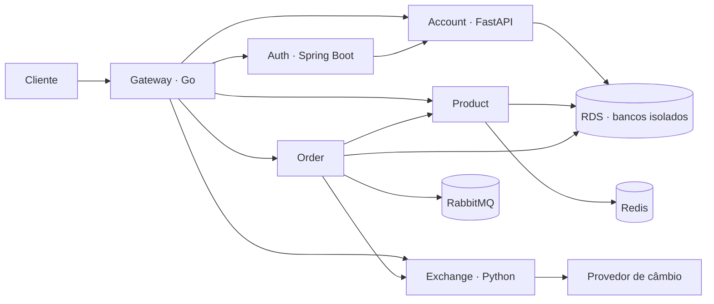

# Microserv Store

Backend de comércio eletrônico desenvolvido para a disciplina **Platforms, Microservices, DevOps and APIs**. O projeto reúne seis microsserviços, autenticação por JWT e implantação no Amazon EKS.

**Integrantes:** Yuri Henrique e Gustavo Lina.

## Arquitetura

O Gateway é o ponto de entrada das APIs. Account gerencia contas, Auth emite tokens, Product mantém produtos, Order registra pedidos e Exchange consulta um provedor externo de câmbio. Os pedidos são armazenados em USD; a conversão é aplicada somente à resposta.

Os serviços executam no mesmo cluster Kubernetes. Prometheus e Grafana fornecem métricas e painéis; Jenkins automatiza testes, publicação de imagens e deploy.

## Responsabilidades e repositórios

| Responsável | Entrega |
|---|---|
| Yuri Henrique | Account, Auth, Gateway, infraestrutura, observabilidade e balanceamento |
| Gustavo Lina | Product, Order, Exchange, cache e mensageria |
| Dupla | Integração, validação e apresentação |

| Código | Repositório |
|---|---|
| Projeto principal | [store-root](https://github.com/Microserv-1/store-root) |
| Account | [store-account](https://github.com/Microserv-1/store-account) |
| Auth | [store-auth](https://github.com/Microserv-1/store-auth) |
| Gateway | [store-gateway](https://github.com/Microserv-1/store-gateway) |
| Product | [store-product](https://github.com/Microserv-1/store-product) |
| Order | [store-order](https://github.com/Microserv-1/store-order) |
| Exchange | [store-exchange](https://github.com/Microserv-1/store-exchange) |

As implementações individuais são incorporadas como submódulos, com commits fixados no repositório principal. Esta documentação corresponde à Pessoa A; a documentação de Gustavo está em [store-docs-b](https://microserv-1.github.io/store-docs-b/).

## Validação

Na conferência de **22/11/2026**, as seis APIs estavam saudáveis no EKS e passaram em 40 verificações de integração. O Gateway permanece privado, acessível por túnel autorizado. Os resultados são registros pontuais de teste.

Consulte [execução](deploy.md), [gargalos e testes](bottlenecks.md) e [evidências](evidence-index.md).
