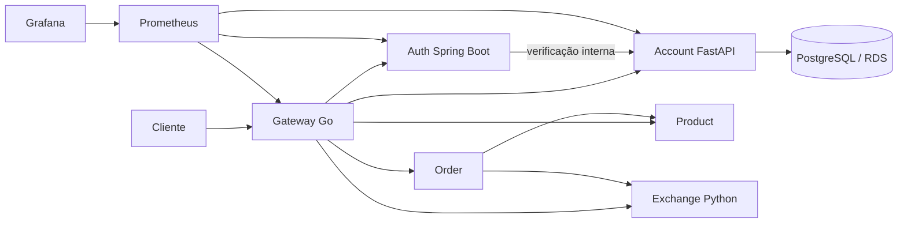

# Microserv Store — Pessoa A

Projeto em dupla, edição 2026, com prazo informado de 16/11/2026. Confirmar horário no Blackboard.

Pessoa A: **Yuri Henrique** (identidade Git configurada; confirmar nome acadêmico completo). Pessoa B: **gustavolafz** (login GitHub; confirmar nome acadêmico completo). A revisão cruzada e a defesa individual continuam necessárias.

## Escopo e arquitetura

Account em Python/FastAPI, Auth em Java/Spring Boot e Gateway em Go. Infraestrutura e dois tratamentos de gargalos: observabilidade e balanceamento. Product, Order e Exchange Python pertencem à Pessoa B.

As integrações de negócio foram testadas com os serviços reais de B, Redis, RabbitMQ e um provedor externo de câmbio. Consulte o [relatório de integração de 11/11](integration.md).

## Repositórios e autoria

| Entrega | Repositório |
|---|---|
| Integração e infraestrutura | [store-root](https://github.com/Microserv-1/store-root) |
| Account | [store-account](https://github.com/Microserv-1/store-account) |
| Auth | [store-auth](https://github.com/Microserv-1/store-auth) |
| Gateway | [store-gateway](https://github.com/Microserv-1/store-gateway) |
| Product | [store-product](https://github.com/Microserv-1/store-product) |
| Order | [store-order](https://github.com/Microserv-1/store-order) |
| Exchange | [store-exchange](https://github.com/Microserv-1/store-exchange) |
| Documentação de B | [store-docs-b](https://github.com/Microserv-1/store-docs-b) |
| Documentação | [store-docs-a](https://github.com/Microserv-1/store-docs-a) |

Os serviços são privados na preparação. Confirmar acesso do avaliador ou visibilidade exigida. O site precisa ser público; a existência do workflow Pages não comprova publicação. Código auxiliado por IA exige revisão do integrante e defesa individual.
