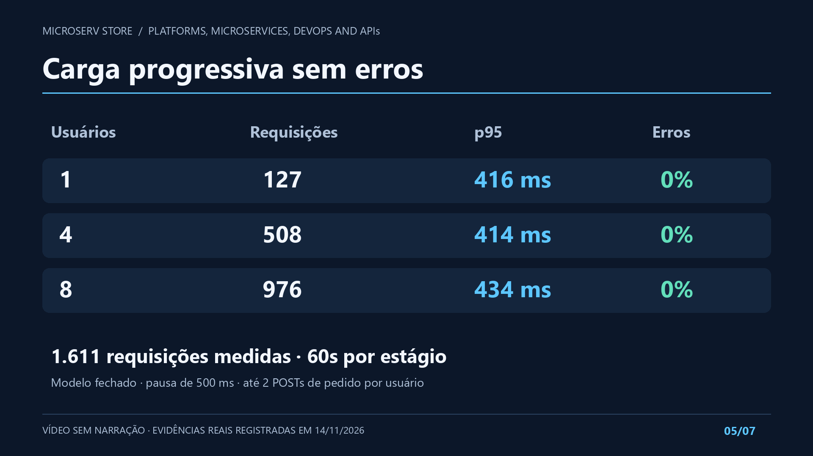
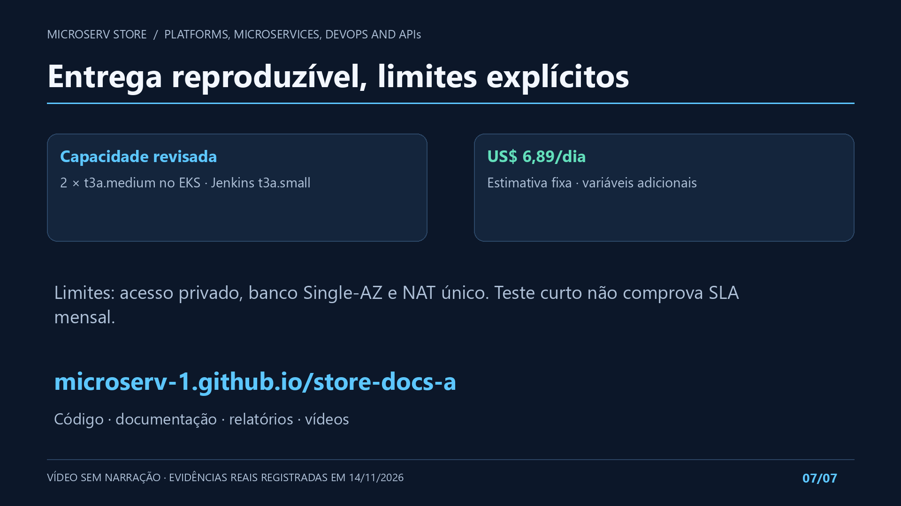

# Vídeo curto do projeto

[Assistir ou baixar o MP4 sem narração — 1 min 56 s](evidence/2026-11-14-presentation-silent/project-presentation.mp4).

<video controls muted preload="metadata" style="width:100%;max-width:1100px" poster="../evidence/2026-11-14-presentation-silent/intro.png">
  <source src="../evidence/2026-11-14-presentation-silent/project-presentation.mp4" type="video/mp4">
  <track kind="captions" src="../evidence/2026-11-14-presentation-silent/captions.pt.vtt" srclang="pt-BR" label="Descrição dos quadros">
  Seu navegador não suporta vídeo. Use o link de download acima.
</video>

Produzido pelo agente e ajustado a pedido de Yuri em 14/11/2026 para ficar
**sem narração e sem faixa de áudio**. Integrantes informados: **Yuri Henrique
e Gustavo Lina**. Os quadros explicativos apresentam as evidências reais da
aplicação em operação, antes da pausa autorizada. A defesa individual continua
sendo dos integrantes; o vídeo não registra participação oral.

## Conteúdo e verificação

- Duração técnica: **116 segundos**, dentro da faixa de 1–2 minutos.
- Vídeo H.264 Full HD 1920×1080, sem áudio, com descrições WebVTT opcionais.
- Arquitetura, fluxo funcional, quatro tratamentos de gargalos, carga,
  HPA, custos e limites baseados nas [evidências reais de 14/11](final-validation.md).
- Edição de material registrado; não simula uma nova execução ao vivo.
  Não houve nova carga, criação ou alteração de recursos AWS para produzi-lo.
- Os sete quadros foram conferidos visualmente; a duração e as faixas de
  vídeo e a ausência de áudio foram verificadas com ffprobe. As descrições
  opcionais têm tempos aproximados por sentença. [Proveniência, fontes e hash](evidence/2026-11-14-presentation-silent/provenance.json).

O [vídeo técnico completo de HPA](evidence/2026-11-14-eks/hpa/hpa-evidence.mp4)
continua separado, com 6min48s, contexto e timestamps das capturas reais.
Ele não precisa caber na duração da apresentação curta.

## Quadros utilizados

Slides são páginas de apoio à apresentação: objetivo, arquitetura, fluxo,
gargalos, resultados e conclusão. Estes sete quadros já estão no vídeo e podem
apoiar a fala da dupla. A exigência de um arquivo separado PowerPoint/PDF não
foi confirmada nos anexos originais; não tratá-la como requisito confirmado.
Um arquivo nativo/editável não foi gerado pelo serviço indisponível.
O conteúdo está no
[roteiro versionado](https://github.com/Microserv-1/store-root/blob/main/presentation/project-video.json).

