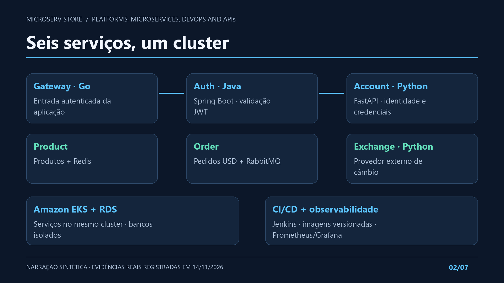
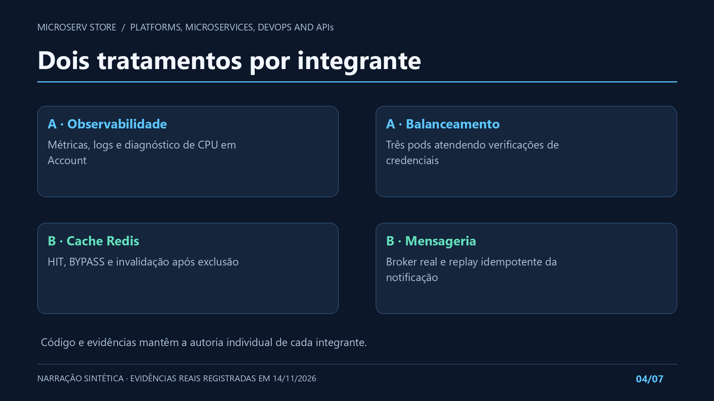
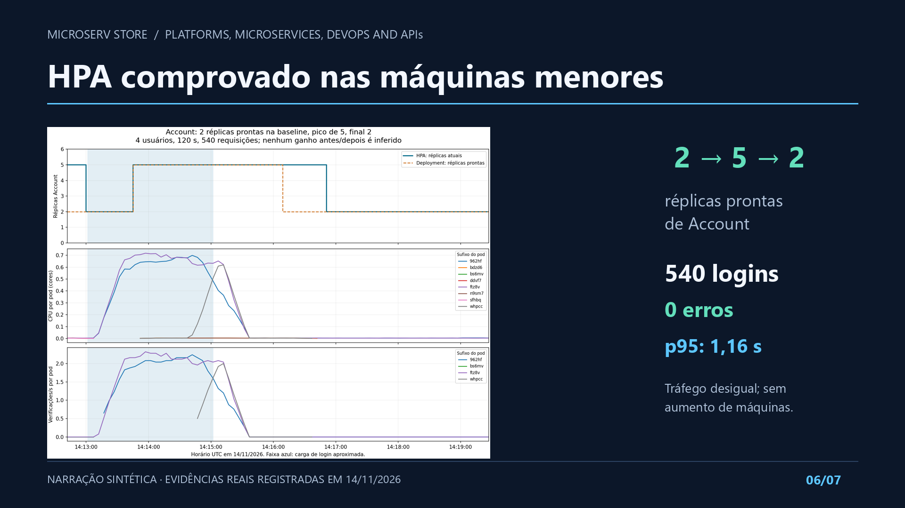

# Vídeo curto do projeto

[Assistir ou baixar o MP4 — 1 min 57 s](evidence/2026-11-14-presentation/project-presentation.mp4).

<video controls preload="metadata" style="width:100%;max-width:1100px" poster="../evidence/2026-11-14-presentation/intro.png">
  <source src="../evidence/2026-11-14-presentation/project-presentation.mp4" type="video/mp4">
  <track kind="captions" src="../evidence/2026-11-14-presentation/captions.pt.vtt" srclang="pt-BR" label="Português" default>
  Seu navegador não suporta vídeo. Use o link de download acima.
</video>

Produzido pelo agente a pedido de Yuri, em 14/11/2026, com **narração
sintética em português**, identificada na tela. Não é a voz de Yuri ou
Gustavo e não comprova participação oral dos alunos. Confirmar a aceitação
desse formato na rubrica original; caso a participação dos integrantes seja
exigida, usar o material como base e substituir/complementar a narração por
gravações reais. A defesa individual continua sendo dos integrantes.

## Conteúdo e verificação

- Duração técnica: **116,63 segundos**, dentro da faixa de 1–2 minutos.
- Vídeo H.264 Full HD 1920×1080, com áudio AAC e legendas WebVTT opcionais.
- Arquitetura, fluxo funcional, quatro tratamentos de gargalos, carga,
  HPA, custos e limites baseados nas [evidências reais de 14/11](final-validation.md).
- Edição de material registrado; não simula uma nova execução ao vivo.
  Não houve nova carga, criação ou alteração de recursos AWS para produzi-lo.
- Os sete quadros foram conferidos visualmente; a duração e as faixas de
  áudio/vídeo foram verificadas com ffprobe. Legendas têm tempos aproximados
  por sentença. [Proveniência, fontes e hash](evidence/2026-11-14-presentation/provenance.json).

O [vídeo técnico completo de HPA](evidence/2026-11-14-eks/hpa/hpa-evidence.mp4)
continua separado, com 6min48s, contexto e timestamps das capturas reais.
Ele não precisa caber na duração da apresentação curta.

## Quadros utilizados

O arquivo nativo/editável de slides permanece pendente por indisponibilidade
do serviço. Estes são os quadros do vídeo, com a narração definida no
[roteiro versionado](https://github.com/Microserv-1/store-root/blob/main/presentation/project-video.json).

